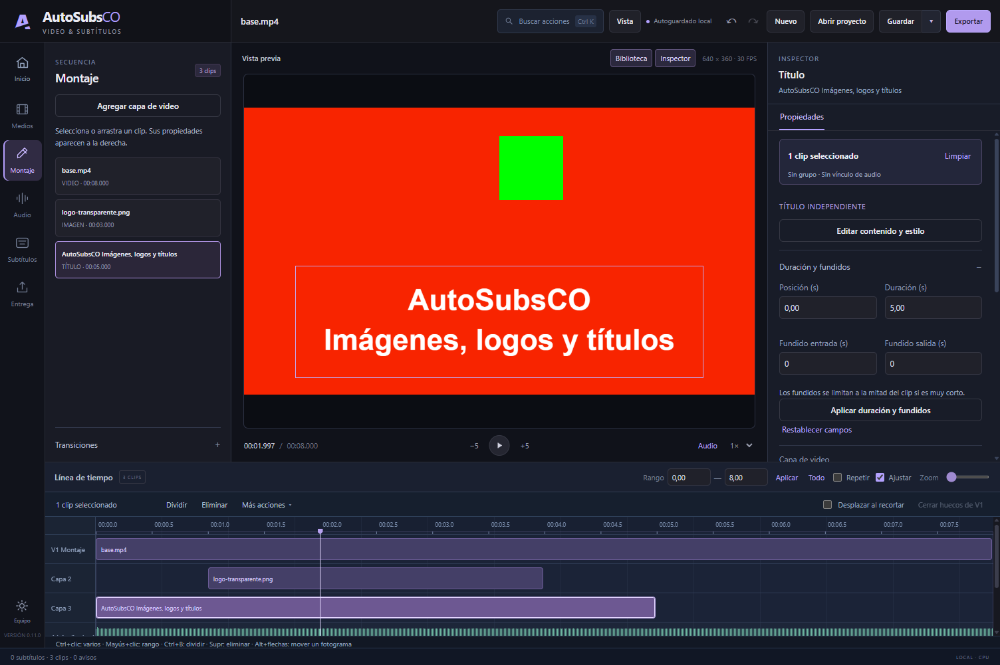

# AutoSubsCO

Editor local para **Windows x64** con montaje multimedia, imágenes, logos, títulos, mezcla de audio y subtítulos automáticos. Versión de desarrollo: **0.11.0**.

**Uso personal y no comercial.** Puedes utilizar y modificar el código bajo [PolyForm Noncommercial 1.0.0](LICENSE). Consulta el [resumen en español](USO_NO_COMERCIAL.md) y los [avisos de terceros](THIRD_PARTY_NOTICES.md).



## Funcionalidades

- **Medios:** biblioteca de video/audio, imágenes PNG/JPEG, logos transparentes y títulos independientes.
- **Montaje:** múltiples capas, selección y agrupación, cortes, recorte, audio vinculado, transiciones, transformación, fotogramas clave y fundidos de gráficos.
- **Audio:** volumen, curvas y fundidos, separación de voz/música, agrupación estimada de hablantes y atenuación de música durante la voz.
- **Subtítulos:** reconocimiento local, comparación de motores, edición, traducción, realineación del español, buscar/reemplazar y cortes de video desde el texto.
- **Entrega:** MP4 H.264/AAC, SRT/VTT/ASS y proyectos transportables con medios relativos.
- **Proyectos:** recientes, Guardar como, versiones, recuperación y Deshacer/Rehacer. El esquema actual es 6 y admite migración de los esquemas 1 a 5.

El visor, el inspector contextual y la línea de tiempo conservan su posición al cambiar de tarea. Los paneles se pueden ajustar y plegar.

La inferencia y el render se ejecutan en el equipo. La preparación inicial descarga herramientas y modelos elegidos. **CPU es la opción predeterminada; GPU es opcional**, con respaldo CPU en los procesos que la admiten.

## Preparar y ejecutar

Requiere Windows x64, Node.js 24 y npm. El repositorio publica fuentes y workers propios; los runtimes y los pesos se preparan por separado.

```powershell
git clone https://github.com/edwincsabo/AutoSubsCO.git
cd AutoSubsCO
npm ci
npm run setup
node scripts/setup-onnx.mjs
node scripts/setup-studio.mjs
```

Coloca `ffmpeg.exe` y `ffprobe.exe` en `tools/ffmpeg/` junto con sus avisos de licencia. La [guía de instalación](docs/INSTALACION.md) explica las alternativas de configuración y preparación.

```powershell
node scripts/download-model.mjs small
npm start
```

También puedes utilizar `Probar AutoSubsCO.cmd` después de preparar las dependencias. Los recursos adicionales se descargan explícitamente desde la herramienta correspondiente. No necesitas instalar otra aplicación AutoSubs.

## Primer montaje

1. Importa tu video o audio desde **Medios**, o comienza con una imagen.
2. En **Imagen y texto**, importa una foto, coloca un logo o crea un título.
3. Selecciona el elemento en **Montaje** para cambiar duración, posición, opacidad y animación.
4. Si necesitas subtítulos, elige modelo, idioma y rango en **Subtítulos → Transcribir**. Revisa el texto y sus tiempos.
5. Guarda y exporta el rango desde **Entrega**. **Empaquetar proyecto y medios** prepara una carpeta transportable.

## Modelos locales

| Herramienta | Opciones |
|---|---|
| Transcripción | Whisper Base, Small y Large v3 Turbo; Orukeet y Parakeet v3 ONNX INT8 |
| Realineación | Wav2Vec2 CTC español ONNX INT8 |
| Separación | Spleeter ONNX, voz y música |
| Turnos de voz | Pyannote / WeSpeaker ONNX |
| Traducción | Argos/OPUS mediante CTranslate2; español, inglés, portugués y francés |

Los catálogos de `src/` fijan procedencia, revisiones, tamaños y SHA-256. Cada modelo mantiene sus términos. La RAM indicada es orientativa; los resultados de reconocimiento, traducción, separación y alineación requieren revisión.

## Desarrollo y pruebas

```powershell
npm test
npm run test:graphics
npm run test:alignment-core
```

La base actual tiene **130 pruebas de dominio**. La validación local de 0.11 también incluyó diez recorridos de interfaz y exportaciones reales. Los resultados de sesiones privadas y sus medios no se publican.

La prueba de gráficos genera sus medios y usa un perfil aislado; requiere Electron, FFmpeg y FFprobe. El núcleo de alineación requiere Python. Otros recorridos necesitan modelos y fixtures: consulta [PRUEBAS.md](docs/PRUEBAS.md).

```powershell
npm run package
```

El empaquetado genera un portátil en `release/`. Los binarios producidos requieren validación propia y, cuando corresponda, firma. Esta publicación entrega el código de desarrollo; no incluye un instalador de 0.11 validado. La distribución de dependencias debe conservar las licencias y obligaciones de cada componente.

## Alcance actual

Hasta 100 clips, 100 recursos y ocho capas de video. Imágenes PNG/JPEG estáticas; títulos de hasta 500 caracteres. Exportación a 24/25/30/50/60 FPS. La realineación actual es para español. Los proyectos extensos y otras combinaciones de hardware requieren medición específica.

Próximas mejoras: copiar/pegar/duplicar clips, controles de pistas, encuadre y color, velocidad de clips y centro de trabajos.

## Licencia y procedencia

El código original se ofrece bajo **PolyForm Noncommercial License 1.0.0**: uso, modificación y distribución según sus condiciones para fines no comerciales. El uso comercial requiere autorización independiente del titular. Conserva [LICENSE](LICENSE) y [NOTICE](NOTICE) al compartir copias.

La licencia no sustituye las de FFmpeg, Electron, los paquetes Python ni los pesos de modelos. Consulta [THIRD_PARTY_NOTICES.md](THIRD_PARTY_NOTICES.md) y `licenses/`.

AutoSubsCO es una implementación propia. [AutoSubs](https://github.com/tmoroney/auto-subs) fue una referencia de comportamiento; no se incorpora su implementación.
